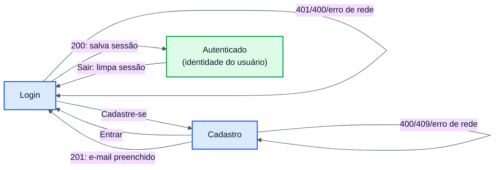

# Desenho do Frontend — AuthSystem

| Item | Valor |
|---|---|
| Projeto | AuthSystem — frontend |
| Versão | 1.0 |
| Requisitos atendidos | RF07, RF08, RF09 (ver [ARQUITETURA.md](ARQUITETURA.md), seção 2) |

---

## 1. Objetivo
Interface web que permite ao usuário **cadastrar-se**, **autenticar-se** e **ver sua identificação** depois do login, consumindo a API descrita na seção 5 de [ARQUITETURA.md](ARQUITETURA.md). Não há regra de negócio no frontend: a decisão de autenticação é sempre do backend.

## 2. Tecnologias

| Item | Escolha | Motivo |
|---|---|---|
| Biblioteca de UI | React 19 | Componentes simples, amplamente conhecida |
| Linguagem | TypeScript (modo `strict`) | Contrato da API tipado; erros detectados na compilação |
| Build/servidor de desenvolvimento | Vite | Configuração mínima |
| Testes | Vitest + Testing Library + jsdom | Testes pelo ponto de vista do usuário (rótulos, papéis ARIA) |
| Análise estática | ESLint (`typescript-eslint`, `react-hooks`) | Padronização e detecção de erros comuns |

Não foi usada biblioteca de rotas nem de estado global: são só três telas (ADR-09).

## 3. Estrutura

```
frontend/src
├── main.tsx                 # ponto de entrada
├── App.tsx                  # navegação entre telas e controle da sessão
├── api/
│   ├── types.ts             # contrato da API (requests, responses, ErrorResponse)
│   ├── authApi.ts           # chamadas HTTP: register(), login()
│   ├── ApiError.ts          # erro tipado com status, code e erros por campo
│   └── errorMessages.ts     # código de erro → mensagem para o usuário
├── validation/rules.ts      # validações no cliente (espelho de RN01–RN04)
├── session/session.ts       # sessão no sessionStorage, com expiração
├── components/              # AuthLayout, Logo (SVG), TextField, PasswordChecklist, SubmitButton, ícones
├── toast/                   # ToastProvider + useToast(): mensagens temporárias
├── pages/                   # LoginPage, RegisterPage, HomePage
└── test/                    # setup e utilitários de teste
```

| Módulo | Responsabilidade | Não deve |
|---|---|---|
| `pages/*` | Estado do formulário, validação local, chamar a API, exibir retorno | Montar requisições HTTP diretamente |
| `api/authApi` | Única porta de saída para a API; converte falhas em `ApiError` | Conhecer componentes de tela |
| `api/errorMessages` | Escolher a mensagem pelo `code` (ADR-06) | Depender do texto enviado pelo servidor |
| `validation/rules` | Retorno imediato ao usuário | Substituir a validação do servidor |
| `session/session` | Guardar token e identidade, descartar sessão expirada | Decodificar ou validar o JWT |
| `toast/*` | Exibir mensagens temporárias (erro da API, sucesso do cadastro) | Decidir o texto da mensagem |

## 4. Fluxo de telas



Ao abrir a aplicação, se houver sessão válida (não expirada) no `sessionStorage`, a tela "Autenticado" é exibida direto.

## 5. Tratamento de erros

A exceção da API (`ApiError`) é capturada na página e exibida num **toast** no canto superior direito. O toast some sozinho em 5 s ou ao clicar em fechar. Erros de campo continuam abaixo do respectivo campo, porque precisam ficar visíveis até serem corrigidos.

| Situação | `code` | O que o usuário vê |
|---|---|---|
| Campo inválido (cliente) | — | Mensagem abaixo do campo; a API não é chamada |
| Campo inválido (servidor) | `VALIDATION_ERROR` | Toast com mensagem geral + mensagem do servidor em cada campo (`errors[]`) |
| Credenciais inválidas | `INVALID_CREDENTIALS` | Toast "E-mail ou senha inválidos." (genérica, RN05); o campo senha é limpo |
| E-mail já cadastrado | `EMAIL_ALREADY_EXISTS` | Toast "Este e-mail já está cadastrado." |
| API fora do ar | `NETWORK_ERROR` (cliente) | Toast "Não foi possível conectar ao servidor…" |
| Erro interno | `INTERNAL_ERROR` | Toast com mensagem genérica + `traceId` para localizar no log |

## 6. Segurança

| Tema | Decisão |
|---|---|
| Senha | Nunca guardada fora do estado do formulário; limpa após login com falha; nunca registrada em log |
| Sessão | `sessionStorage` (some ao fechar a aba); descartada ao expirar (`expiresIn`) ou ao sair (ADR-10) |
| XSS | Todo conteúdo é renderizado pelo React, que escapa texto; não há `dangerouslySetInnerHTML` |
| CORS | O servidor de desenvolvimento roda na porta 3000, a origem liberada pela API |
| Enumeração de usuários | A tela de login não diferencia e-mail inexistente de senha errada |

## 7. Identidade visual

- **Marca:** logo da UFG redesenhada em SVG (`components/Logo.tsx`), com variante colorida e branca; fica nítida em qualquer tamanho.
- **Paleta análoga** ao azul institucional `#0072BC`: índigo `#2E4A9E` (azul-violeta) ← azul UFG → ciano `#0AA1C7`. Usada no gradiente do painel da marca, no botão principal e no avatar. Vermelho e verde ficam reservados para erro e sucesso.
- **Layout:** duas colunas no desktop (painel da marca com hexágonos decorativos + cartão do formulário). Abaixo de 860 px, o painel some e a logo colorida aparece no topo do cartão.
- **Tela autenticada:** avatar com as iniciais, selo "Autenticado" e os dados de identificação em destaque.

## 8. Usabilidade e acessibilidade

- Campos com ícone, *placeholder* de exemplo e foco automático no primeiro campo relevante.
- Botão **mostrar/ocultar senha** (`aria-pressed`, `aria-label` "Mostrar senha"/"Ocultar senha").
- No cadastro, **checklist da senha** em tempo real com os requisitos da RN03; cada item informa "(atendido)" ou "(pendente)" para leitores de tela.
- Indicador de carregamento (*spinner*) e `aria-busy` no botão durante a requisição.
- Todo campo tem `<label>` associado; erros ligados ao campo por `aria-describedby` e marcados com `aria-invalid`.
- Toasts de erro usam `role="alert"` e os de sucesso `role="status"` (anunciados por leitores de tela); botão de fechar com `aria-label`; animação desligada com `prefers-reduced-motion`.
- `autocomplete` adequado (`email`, `current-password`, `new-password`) para gerenciadores de senha.
- Botão de envio desabilitado durante a requisição, com texto indicando o andamento.
- Foco visível, contraste adequado e todas as animações desligadas com `prefers-reduced-motion`.

## 9. Configuração

| Variável | Padrão | Uso |
|---|---|---|
| `VITE_API_URL` | `http://localhost:8080` | URL base da API |

## 10. Testes
Os testes simulam a API substituindo `fetch`, sem precisar do backend rodando. Os identificadores `CT-*` aparecem na matriz de rastreabilidade de [QUALIDADE.md](QUALIDADE.md).

| Arquivo | Casos | Alvo |
|---|---|---|
| `validation/rules.test.ts` | CT-V01 a CT-V10 | Regras RN01–RN04 no cliente, checklist da senha |
| `api/authApi.test.ts` | CT-A01 a CT-A07 | Requisição HTTP, conversão de erros, mensagens |
| `session/session.test.ts` | CT-S01 a CT-S05 | Criação, expiração e remoção da sessão |
| `App.test.tsx` | CT-F01 a CT-F12 | Fluxos completos de tela, mostrar senha, checklist |
| `toast/ToastProvider.test.tsx` | CT-T01 a CT-T04 | Exibição, expiração automática e fechamento do toast |
